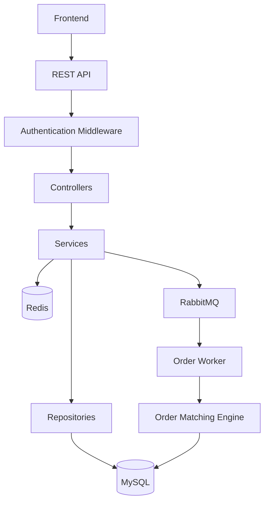
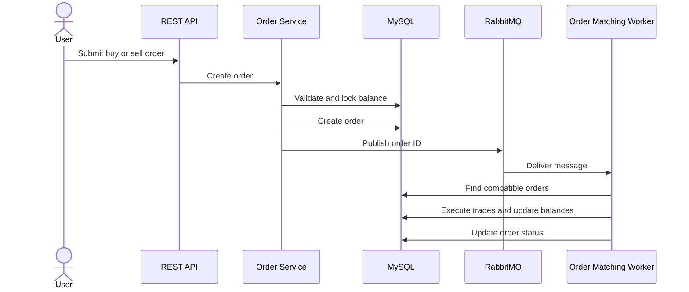

# Cryptocurrency Exchange Simulator


## Overview

A full-stack cryptocurrency exchange simulator designed to reproduce the core operations of a digital asset trading platform.

The application allows users to manage virtual balances, place and cancel Bitcoin buy and sell orders, view the order book, and execute trades through an asynchronous order matching engine.

The project demonstrates backend development, financial business rules, asynchronous processing, database transaction management, authentication, and containerized infrastructure.

This project is intended for educational and portfolio purposes only. It does not process real financial transactions or cryptocurrency transfers.

## Features

### Authentication and User Management

- JWT-based authentication
- Password hashing with bcrypt
- Authentication middleware
- Role-based access control
- Session management

### Order Management

- Buy and sell Bitcoin orders
- Order cancellation
- Active order listing
- Order history
- Balance validation
- Available and locked balance management

### Order Matching Engine

- Automated matching of buy and sell orders
- Price-time priority matching
- Full and partial order execution
- Asynchronous order processing with RabbitMQ
- Prevention of self-trading
- Maker and taker fee calculation
- Trade registration
- Transactional balance updates

### Market Data

- Aggregated order book
- Bid and ask listings
- Trade history
- Trading statistics

## Tech Stack

### Backend

| Technology | Purpose |
| --- | --- |
| Node.js | Runtime environment |
| TypeScript | Type-safe application development |
| Express.js | RESTful API |
| Sequelize | Object-relational mapping |
| MySQL | Relational database |
| Redis | In-memory data storage |
| RabbitMQ | Message broker and asynchronous processing |
| JWT | Token-based authentication |
| bcrypt | Password hashing |
| Decimal.js | Decimal arithmetic for financial operations |
| Umzug | Database migrations |
| Babel | Source code transpilation |

### Infrastructure

- Docker
- Docker Compose
- Environment-based configuration

## Architecture

The backend follows a layered architecture with separation of responsibilities between HTTP request handling, business logic, data access, and infrastructure.



### Architectural Principles

- Separation of concerns
- Repository pattern
- Service layer pattern
- Interface-based contracts
- Asynchronous message processing
- Database transaction management
- Environment-based configuration

## Project Structure

```text
crypto-exchange-simulator/
├── backend/
│   ├── src/
│   │   ├── config/
│   │   ├── controllers/
│   │   ├── enums/
│   │   ├── middlewares/
│   │   ├── migrations/
│   │   ├── models/
│   │   ├── queue/
│   │   ├── repositories/
│   │   │   └── interfaces/
│   │   ├── services/
│   │   │   └── interfaces/
│   │   ├── types/
│   │   ├── routes.ts
│   │   └── server.ts
│   ├── Dockerfile
│   ├── docker-compose.yml
│   └── package.json
├── frontend/
└── README.md
```

## Trading Workflow



## Business Rules

### Balance Management

Each user has available and locked balances in BTC and USD.

- Buy orders reserve the corresponding USD amount.
- Sell orders reserve the corresponding BTC amount.
- Order cancellation releases the remaining reserved balance.
- Trade execution updates the balances of both participants.

### Order Matching

The matching engine identifies compatible orders based on price and creation time.

- Buy orders are matched against compatible sell orders.
- Sell orders are matched against compatible buy orders.
- Better prices receive priority.
- Orders at the same price are prioritized by creation time.
- Orders may be executed fully or partially.
- Users cannot trade against their own orders.

### Financial Consistency

Database transactions and row-level locking are used in critical order and trade operations to help maintain data consistency during concurrent execution.

Decimal.js is used in the matching engine to improve arithmetic precision during financial calculations.

## Security

The application incorporates the following security mechanisms:

- JWT-based authentication
- Password hashing
- Protected routes
- Role-based authorization
- Order ownership validation
- Balance validation
- Configurable CORS policy
- Environment variables for sensitive configuration

## API

The backend exposes a RESTful API organized into the following functional areas:

| Resource | Responsibility |
| --- | --- |
| Authentication | User authentication and session management |
| Users | User information and management |
| Orders | Order creation, cancellation, and consultation |
| Order Book | Aggregated buy and sell orders |
| Trades | Executed trade information |
| Statistics | Trading statistics |
| Health | Application health endpoint |

The application provides a basic health endpoint:

```http
GET /health
```

Example response:

```json
{
  "status": "ok"
}
```

## Getting Started

### Prerequisites

Before running the project, make sure you have the following tools installed:

- Git
- Node.js
- npm
- Docker
- Docker Compose

### Clone the Repository

```bash
git clone https://github.com/cspclaudia/crypto-exchange-simulator.git

cd crypto-exchange-simulator
```

### Environment Configuration

Configure the required environment variables in the backend before starting the application.

The configuration includes:

- Database connection settings
- Redis connection settings
- RabbitMQ connection settings
- JWT secret
- Application port
- Frontend URL

Never commit production credentials or sensitive configuration files to the repository.

### Running the Backend

```bash
cd backend
npm install
npm run build
docker compose up --build
```

The backend uses port `3001` by default.

```text
http://localhost:3001
```

### Running the Frontend

In a separate terminal:

```bash
cd frontend
npm install
npm run build
npm start
```

The frontend runs outside Docker.

### Type Checking

To validate the backend TypeScript code:

```bash
cd backend
npm run typecheck
```

### Stopping the Containers

```bash
cd backend
docker compose down
```

## Technical Highlights

This project explores the following software engineering concepts:

- RESTful API design
- Layered architecture
- Object-oriented programming
- Repository and service patterns
- Message queues
- Asynchronous processing
- Concurrent database operations
- ACID transactions
- Financial arithmetic precision
- Authentication and authorization
- Relational database modeling
- Database migrations
- Containerized infrastructure

## Future Improvements

- Unit and integration tests
- End-to-end testing
- OpenAPI and Swagger documentation
- Transactional Outbox pattern
- Message processing idempotency
- Retry policies and dead-letter queues
- Improved financial precision across all business operations
- Enhanced balance reconciliation
- Structured logging
- Metrics and distributed tracing
- API rate limiting
- Enhanced health checks
- CI/CD pipelines with GitHub Actions
- Frontend containerization
- Cloud deployment
- Support for multiple cryptocurrency trading pairs

## Author

**Cláudia dos Santos Pereira**

Software Developer | Backend Development | Software Architecture

- [GitHub](https://github.com/cspclaudia)
- [LinkedIn](https://www.linkedin.com/in/cspclaudia/)

---

Developed for educational purposes and to demonstrate practical software engineering concepts through a cryptocurrency trading simulation.
